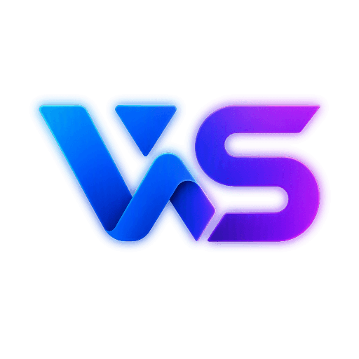

<div align="center">



# Widget Studio

Build, preview, and share compact, data-driven widgets in the browser.

[](https://angular.dev/)
[](https://www.typescriptlang.org/)
[](https://echarts.apache.org/)
[](LICENSE)

[Features](#features) • [Getting started](#getting-started) • [Using the editor](#using-the-editor) • [Development](#development) • [Project structure](#project-structure)

</div>

Widget Studio is an Angular editor for composing widgets from a version 2 widget contract. Add content to a grid canvas, configure it with an inspector, see the generated JSON and C# contract code as you work, and share a compressed widget model through a URL.

The workspace also contains [`widget-renderer`](projects/widget-renderer/README.md), the reusable Angular package that renders the same widget contract, [`widget-landscape`](projects/widget-landscape/README.md) for arranging widgets in a dashboard grid, and the [`WidgetStudio.Contracts`](projects/widget-contracts/widget-contracts/README.md) .NET package for producing compatible JSON. This README focuses on the editor.

## Features

- **Visual composition**: add elements from a palette and arrange them on a grid canvas.
- **Layer management**: select, delete, clear, reorder, and move elements between layers.
- **Element inspector**: configure content, styling, grid placement, spans, anchors, and sensitive-content behavior.
- **Charts and data displays**: create pie, donut, funnel, gauge, bar, line, and progress elements alongside text, images, dividers, and actions.
- **Live output**: inspect the JSON widget model generated by the editor.
- **Preview mode**: view the widget without the editing controls and exercise refresh and button events.
- **Shareable links**: encode the current model into a compressed `#widget=...` URL hash and load it again in the editor.
- **Light and dark themes**: switch themes from the header; the preference is retained locally when browser storage is available.
- **Accessible interactions**: keyboard-friendly controls, dialog focus handling, chart summaries, and sensitive-content controls are covered by tests.

> [!NOTE]
> The editor is a client-side development tool. Widget button and refresh events are surfaced in the UI; the editor does not make application-specific network requests for them.

## Getting started

### Prerequisites

- [Node.js](https://nodejs.org/) compatible with Angular 22
- npm 12.0.2, as declared by the project

Install the locked dependency tree from the repository root:

```bash
npm ci
```

Start the development server:

```bash
npm start
```

Open [http://localhost:4200/](http://localhost:4200/) in a browser.

## Using the editor

1. Choose a starter widget from the sample selector, or begin with the current canvas.
2. Drag an element from **Elements** onto the canvas, or add it using the palette control.
3. Select an element to edit its content, appearance, action metadata, chart data, or sensitivity setting in **Settings**.
4. Adjust row, column, row span, and column span values to control the element's grid position.
5. Select the widget background to edit widget-level settings and grid tracks.
6. Use **Preview** to inspect the rendered widget and test its interactive states.
7. Use **Share** to create a URL for the current model.
8. Copy the JSON shown in **Output contract** when the model needs to be sent to another application.

### Supported elements

| Element | Use it for |
| --- | --- |
| Text | Formatted labels, headings, and copy |
| Image | Remote imagery with alternative text and fit options |
| Action | `GET` or `POST` button metadata |
| Divider | Horizontal or vertical separators |
| Pie and donut | Part-to-whole data |
| Gauge | A value within a range |
| Bar and line | Comparisons and trends |
| Progress | Completion values with labels and legends |

> [!WARNING]
> Sensitive content is blurred and hidden from the accessible tree until revealed, but it is not encrypted. Values remain in the widget model and in any generated share URL.

## Development

Useful commands from the workspace root:

```bash
# Run the editor in development mode
npm start

# Build the editor
npm run build:app

# Build the editor and both Angular libraries
npm run build

# Check formatting
npm run format:check

# Format source files
npm run format

# Run lint checks
npm run lint

# Run unit tests without watch mode
npm test -- --watch=false
```

The production build applies bundle and component-style budgets. The test suite includes editor state, layout, hydration, validation, sharing, accessibility, sensitive content, loading, image failure, and rendering behavior.

### Library development

The editor imports the renderer through the workspace TypeScript path alias. To verify the separately packaged library rather than only the application integration, run:

```bash
npm run build:renderer
npm run verify:renderer-package
```

See [`projects/widget-renderer/README.md`](projects/widget-renderer/README.md) for installation, contract details, public exports, and renderer usage.

### C# contracts

The [`WidgetStudio.Contracts`](projects/widget-contracts/widget-contracts/README.md) NuGet package provides the C# API contracts for the JSON consumed by `widget-renderer`. It targets `netstandard2.0` and uses a source-generated `System.Text.Json` context to preserve the shared renderer wire format. Pack it from the workspace root with:

```bash
dotnet pack projects/widget-contracts/widget-contracts/WidgetStudio.Contracts.csproj

# Run contract and renderer compatibility tests
dotnet test projects/widget-contracts/WidgetStudio.slnx
```

## Project structure

```text
src/
├── app/
│   ├── editor-canvas/       Canvas interaction and element overlays
│   ├── canvas-workspace/    Canvas, samples, and rendered widget surface
│   ├── element-palette/     Available widget building blocks
│   ├── layer-panel/         Element selection and layer ordering
│   ├── settings-panel/      Widget and element configuration controls
│   ├── output-contract/     Live JSON model output
│   ├── preview-dialog/      Render-only preview
│   ├── share-dialog/        Share URL creation
│   ├── editor-state-store.ts
│   └── editor-model.ts      Editor models with internal element IDs
└── styles/                  Shared editor tokens, theme, and controls

projects/widget-renderer/
├── src/lib/                 Reusable renderer implementation
├── src/public-api.ts        Package entry point
└── README.md                Renderer package documentation

projects/widget-landscape/
├── src/lib/                 Reusable landscape implementation
├── src/public-api.ts        Package entry point
└── README.md                Landscape package documentation

projects/widget-contracts/
├── widget-contracts/        C# NuGet contract library
├── widget-contracts.Tests/  Contract and JSON compatibility tests
└── WidgetStudio.slnx        .NET solution
```

The editor uses internal element IDs for selection and layer operations. The renderer accepts the public `WidgetContract` without those editor-only IDs; see the renderer documentation for the distinction.

## Technology

- [Angular](https://angular.dev/) 22 standalone components and signals
- [TypeScript](https://www.typescriptlang.org/)
- [Apache ECharts](https://echarts.apache.org/) for chart rendering
- [Vitest](https://vitest.dev/) for unit tests
- [ng-packagr](https://github.com/ng-packagr/ng-packagr) for the renderer library build
- [C#](https://learn.microsoft.com/en-us/dotnet/csharp/) contracts targeting `netstandard2.0`
- [NuGet](https://www.nuget.org/) for distributing `WidgetStudio.Contracts`
- [System.Text.Json](https://learn.microsoft.com/en-us/dotnet/standard/serialization/system-text-json) source generation for contract serialization

## Further reading

- [Widget Renderer README](projects/widget-renderer/README.md)
- [Widget Contracts README](projects/widget-contracts/widget-contracts/README.md)
- [Angular documentation](https://angular.dev/)
- [ECharts documentation](https://echarts.apache.org/en/option.html)
